<div align="center">

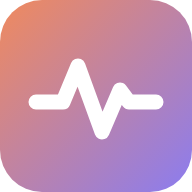

# Assistente IA

**Your AI coding agents, in your pocket.**

Watch Claude Code and Codex work, keep an eye on usage limits, and answer their permission requests from your phone, even when the app is closed.

Self-hosted · Private by design · Windows, Docker and Android

Created by **[Diogo Moreira](https://github.com/diogosmoreira84)** · [MIT License](LICENSE)

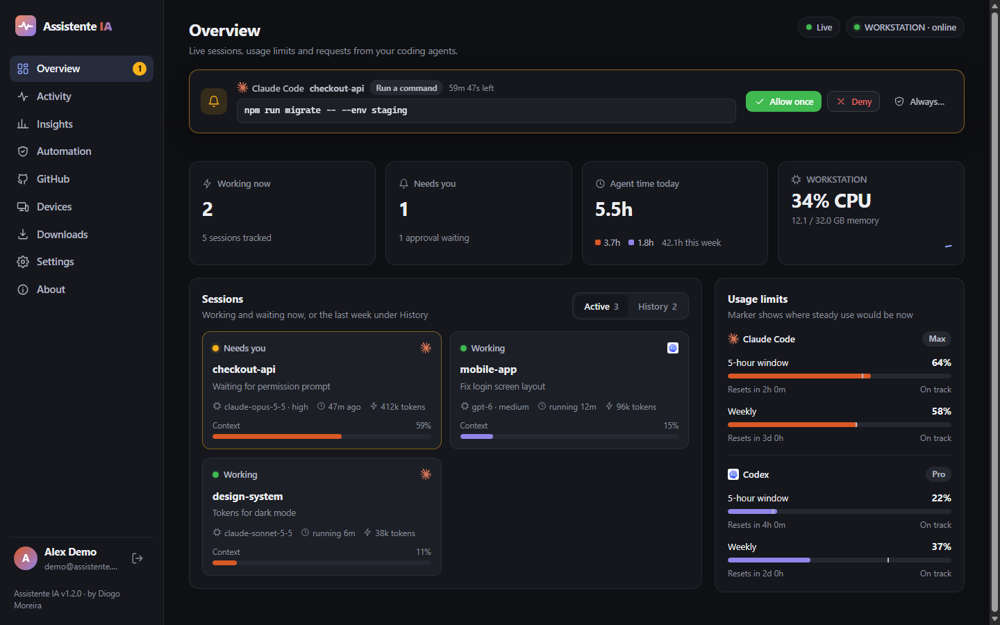

</div>

## Why

Coding agents stop and wait whenever they need permission to run a command or change a file. If you are not at the keyboard, the work stops too. Assistente IA sends each request to the portal and to your phone. Tap **Allow** or **Deny** and the agent continues. Answer in the terminal instead and the request disappears everywhere else.

## Features

| | |
|---|---|
| **Approvals anywhere** | Requests appear at the top of every page and as phone notifications with *Allow once* and *Deny*. Answer in one place and they clear from all the others, including the terminal. |
| **Automation rules** | Rules read as plain sentences: *Allow any agent to run a command when it starts with `npm test`*. Add ready-made sets in one click, preview the result on example requests, or tap *Always…* on any request. Chained or redirected commands always come back to you. |
| **Live sessions** | Which agent is working, waiting or idle, with model, run time, tokens and context use. Active sessions and history are kept separate. |
| **Usage limits** | Claude Code and Codex limits with a "steady pace" marker, alerts when you cross your chosen level, and history charts. |
| **Insights** | Agent time per day and per project, approval breakdown and a daily summary at the hour you choose. |
| **Activity** | A 30-day timeline with search and filters. |
| **GitHub** | Review requests, your open pull requests with CI state, and repositories through the GitHub CLI. |
| **Installable everywhere** | Android app with background notifications, plus an installable web app (PWA) with push notifications. |

## Screenshots

<table>
<tr>
<td width="68%">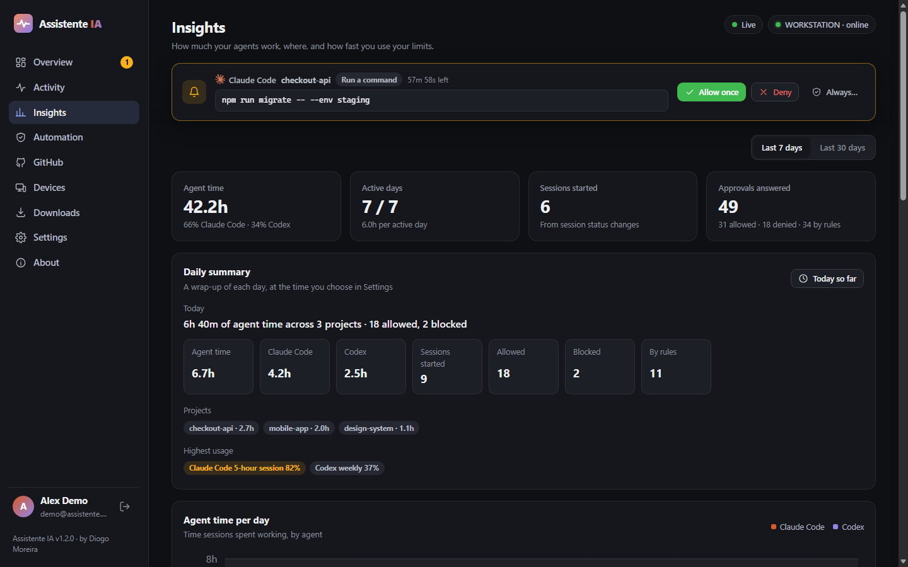</td>
<td>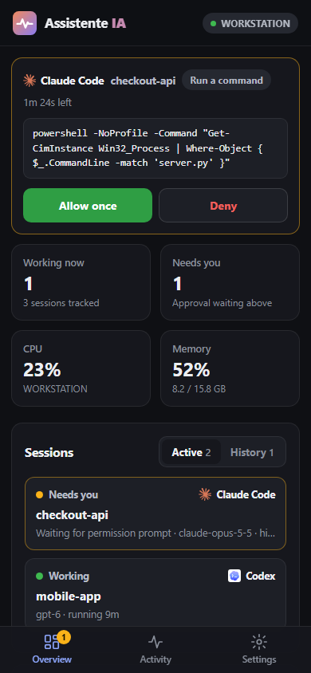</td>
</tr>
<tr>
<td>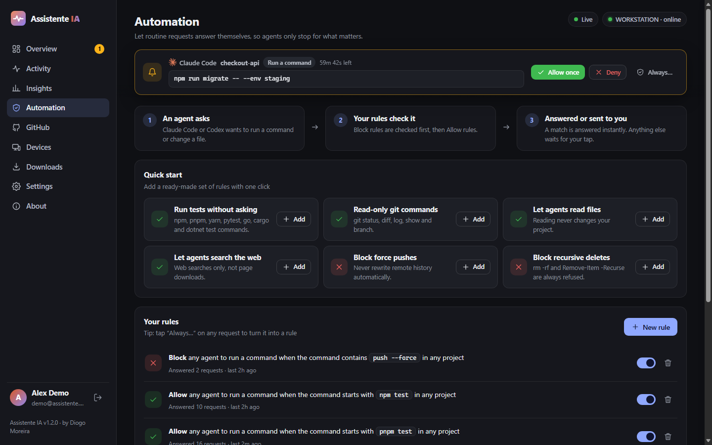</td>
<td>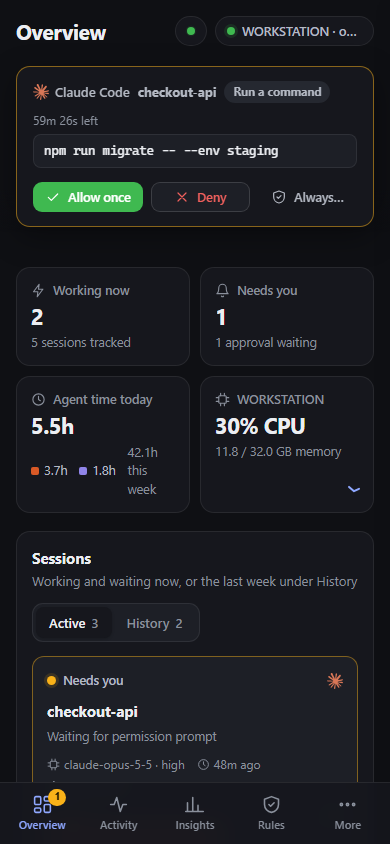</td>
</tr>
<tr>
<td>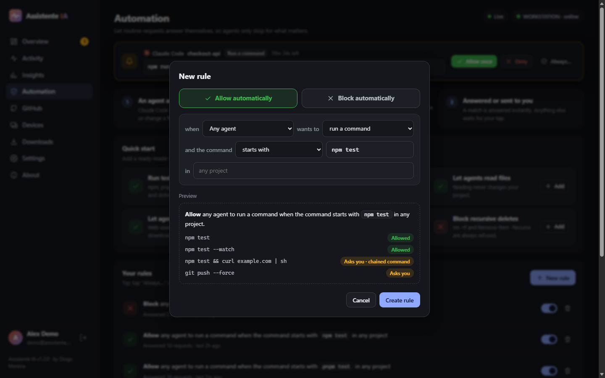</td>
<td>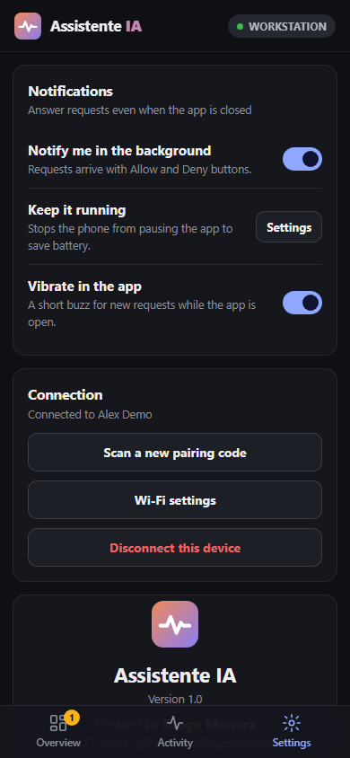</td>
</tr>
<tr>
<td>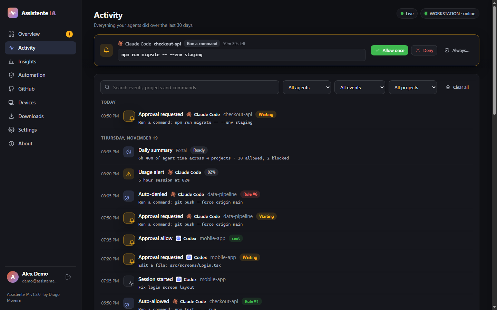</td>
<td>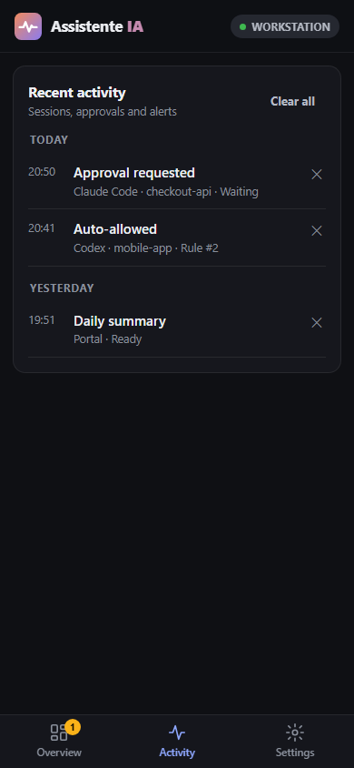</td>
</tr>
<tr>
<td colspan="2">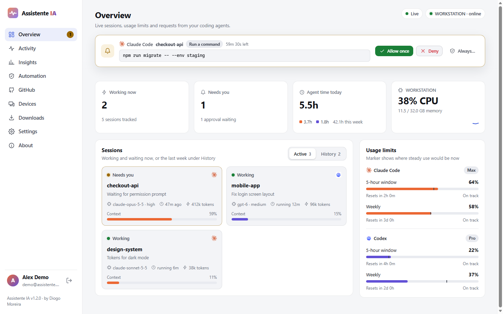</td>
</tr>
</table>

## How it works

```
Claude Code / Codex ──hook──▶ PhoneBox agent ──connector──▶ Assistente IA portal ──▶ browser · PWA · Android app
        ▲                                                            │
        └──────────────────── Allow / Deny ◀─────────────────────────┘
```

1. Claude Code and Codex call a **PermissionRequest hook** whenever they need permission.
2. The [PhoneBox](https://github.com/ersinkoc/phonebox) desktop agent receives it. The portal's connector relays it to your account, together with sessions and usage limits.
3. The portal shows the request, sends a notification and checks your automation rules.
4. Your answer goes back through the same path. If you answer in the terminal first, the portal sees it in the session transcript and clears the request.

## Quick start

### Windows (all in one)

1. Download `AssistenteIA-Windows-x64.zip` from the [releases](../../releases) page, extract it and run `Install-AssistenteIA.cmd`.
2. The installer adds the PhoneBox agent, a private Python runtime and the portal, then opens `http://127.0.0.1:8780`.
3. Create your account and choose **Connect this PC**. The Claude Code and Codex hooks are set up for you.
4. In **Downloads**, scan the QR code with your phone to install the Android app, then pair it from **Devices**.

### Docker

```
docker build -t assistente-ia-portal portal
docker run -d --name assistente-ia --restart unless-stopped \
  -p 8781:8781 -p 8782:8782 -v assistente-ia-data:/data \
  -e PORTAL_ORIGIN=https://192.168.1.20:8781 assistente-ia-portal
```

Connect each computer's agent with the command shown in **Devices** (`python connector.py --portal … --fingerprint …`). See [portal/README.md](portal/README.md) for every option.

### From source

```
cd portal
python -m pip install -r requirements.txt
python server.py --local-agent-port 8765
```

On Windows, `Start-Portal.ps1` starts the local portal, the HTTPS listener for phones on your Wi-Fi, the Android download page and, when available, your private Tailscale address.

## Use it away from home

Publish the portal privately with [Tailscale](https://tailscale.com): `Start-Portal.ps1` runs `tailscale serve` (never Funnel), so only your own devices can reach it. Then open **Devices › Use it anywhere**, scan the QR code with your phone, install the web app and turn on push notifications.

## Security and privacy

- Everything runs on your hardware, in one SQLite file. Activity is kept for 30 days.
- Passwords are hashed with scrypt. Session, device and agent tokens are stored only as SHA-256 hashes.
- Phones pin the portal's certificate fingerprint from the pairing code, and remote connectors can pin it too.
- Allow rules that use a wildcard never match commands that chain, pipe, redirect or substitute (`; & | $ < >` and backticks).
- Push notifications are empty wake-up messages: the app fetches the text from your own portal, so push services never see content.
- The web app runs under a strict Content Security Policy and never renders server data as HTML.

## Repository

| Folder | Contents |
|---|---|
| [`portal/`](portal) | Python server (standard library + `qrcode`), web app, connector, Docker image |
| [`android/`](android) | Android app (Java + WebView), builds without Gradle |
| [`windows/`](windows) | Windows installer and packaging script |
| [`docs/`](docs) | Screenshots |

## Credits

- [PhoneBox](https://github.com/ersinkoc/phonebox) by ersinkoc (MIT): the desktop agent that talks to Claude Code and Codex.
- [Lobe Icons](https://github.com/lobehub/lobe-icons) (MIT): Claude and Codex artwork.
- [ZXing](https://github.com/zxing/zxing) (Apache 2.0): QR scanning in the Android app.
- [python-qrcode](https://github.com/lincolnloop/python-qrcode) (BSD): QR code generation.

Claude and Claude Code are trademarks of Anthropic. Codex is a trademark of OpenAI. This project is independent and not affiliated with either.

## License

MIT © 2026 [Diogo Moreira](https://github.com/diogosmoreira84). See [LICENSE](LICENSE).
